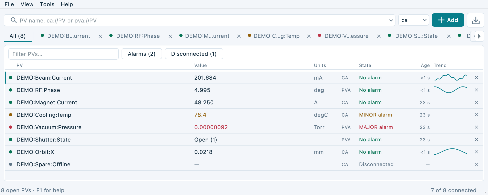
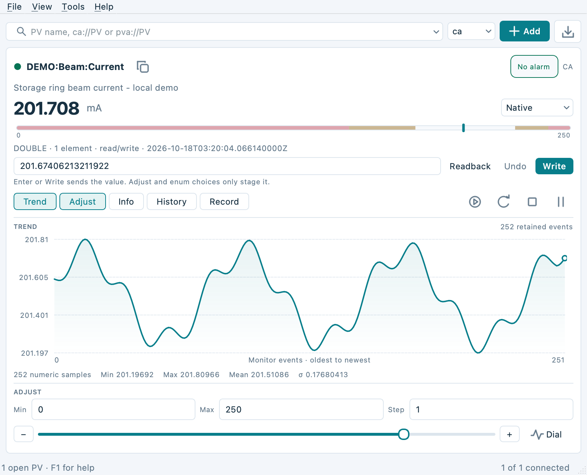
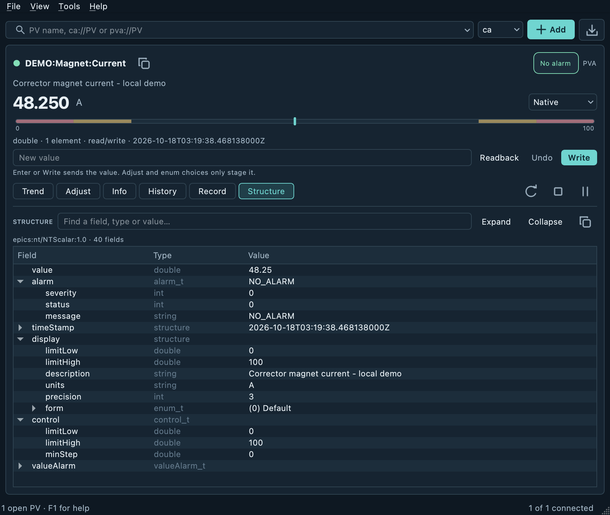
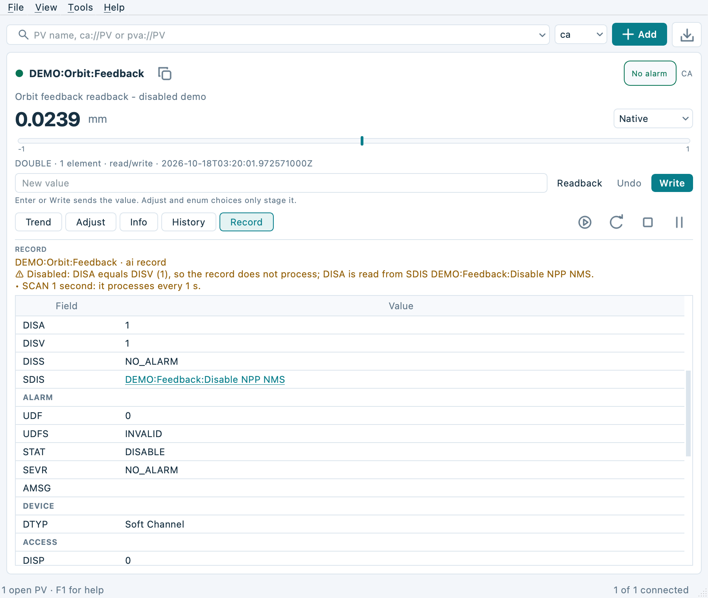

# Probe and QtProbe

This fork preserves the original Motif Probe in `probe/` and adds **QtProbe 0.1.0**,
a C++17 Qt 5.15/Qt 6 PV inspector in `qtprobe/`, following the layout and build
conventions of QtEDM, QtALH and Qt StripTool.

QtProbe supports Channel Access and native pvAccess, enum and numeric
adjustments, arrays, searchable metadata, local history and plots, JSON/CSV
export, sessions and a display-free `--info` command.

## Feature highlights

These screenshots show QtProbe running on macOS with Qt 6 and a local demo
IOC. All PV names and values are demonstration data.

### Monitor CA and PVA together

The **All** view brings live values, units, alarm states, update ages and
sparklines into one sortable table. Filter by name, alarms or disconnected
PVs to find the channels that need attention.



### Follow trends and stage adjustments

Inspect the live value alongside an alarm-band range gauge, a local trend
plot and sample statistics. The **Adjust** slider and step controls stage a
value in the write box; **Write** sends it to the PV.



### Explore native pvAccess structures

Browse the PVA field tree with field names, types and values, including alarm,
display and control metadata. Search and copy fields without leaving the
inspector. The dark appearance is shown here.



### Find out why a record is not updating

The **Record** section reads processing fields and explains common problems
in plain language. Here it identifies a disabled record, shows the matching
**DISA** and **DISV** values, and provides a clickable **SDIS** link to the
disable source.



## More features

The window is compact and fits its content, like the original Probe. With one
PV it shows the live value, alarm state, an inline write box and toggles for
the Trend, Adjust, Info, Array, History and Record sections, plus Structure, a
live tree of every field, for PVA PVs. With several PVs
a tab strip appears; the pinned **All** tab shows one table row per PV with its
value, units, state, update age and a sparkline. The table sorts, filters to
alarms or disconnected PVs, copies rows as text or CSV and works from the
keyboard.

Values honour the PV precision, enums plot as named states, numeric PVs show a
range gauge with alarm bands, and CA char waveforms and `$` fields read and
write as text. Undo, Process (CA), confirm-before-write and a session write log
support safe changes. The Record section shows a record's processing fields
and clickable links, and explains why it may not be updating (disabled, PACT
stuck, UDF, alarm cause, SCAN, deadband). History has hard count and memory
limits, so QtProbe can run for days.

Drag PVs from QtEDM or legacy Motif MEDM with the middle mouse button and drop
them anywhere in the workspace; duplicates reuse their existing connection.
Paste several names at once, drag names out to QtEDM or QtStripTool, open
selections in QtStripTool, and zoom the interface (Ctrl+= / Ctrl+−). CA and
PVA channels can share the same workspace. Light/dark/system appearance, zoom
and the open sections are remembered.

The Help menu follows the other Qt ports: F1 Help Topics, a searchable topic
browser, Keyboard Shortcuts, User Manual, and an animated About dialog with
author credits. Help is embedded and works offline; `QTPROBE_HELP_PATH` can
select an installed or site-hosted manual.

## Build and run

```sh
make -j4                         # QtProbe and legacy Probe when Motif is available
make qtprobe                     # Qt only; no Motif dependency
make probe                       # original Motif application
make -C qtprobe QT_VERSION=5 -j4 # or QT_VERSION=6
bin/Linux-x86_64/qtprobe My:PV pva://My:PVA
bin/Linux-x86_64/qtprobe --read-only My:PV
bin/Linux-x86_64/qtprobe --info --json My:PV pva://My:PVA
make test                        # model, offscreen UI, isolated IOC tests
```

Build products go to `bin/<OS>-<architecture>/`; Qt object directories include
the Qt major. `make clean` removes objects; `make distclean` also removes local
binaries. Both clean targets work without installed dependencies.

Requirements: GNU Make, C++17 compiler, Qt Core/Gui/Widgets/Network development
files, and built EPICS Base. Qt Test is used by tests. The build discovers
Base at `/usr/local/oag/base`, a sibling `epics-base`, or `$HOME/epics/base`;
override with `EPICS_BASE=/path/to/base EPICS_HOST_ARCH=linux-x86_64`.
Qt is discovered with the system `pkg-config` or `qmake`; set `QT_VERSION`,
`PKG_CONFIG`, `QMAKE`, `QMAKE6`, `MOC` or `RCC` for other installations. On
Linux the build uses `/usr/bin/pkg-config` and the distribution's `qmake`, so a
Conda environment earlier in `PATH` cannot select Conda's Qt.
If Base has pvAccess/pvData, PVA is enabled automatically. CA-only builds report
an explicit error for `pva://` names. Legacy Probe additionally requires Motif,
Xt and X11. QtProbe does not link Motif.

On APS Linux, the default uses the installed GCC 11.3 toolchain and a static
C++ runtime, matching the other Qt ports. Set `CUSTOM_GCC_PATH=` to use the
system compiler. Clean before changing compilers or dependency paths.

For native Windows, run these commands from PowerShell or Command Prompt:

```powershell
.\build-windows.bat build 4
.\build-windows.bat rebuild 4
.\build-windows.bat test 4
```

The launcher initializes the installed Visual Studio x64 C++ tools, checks
dependencies and configures runtime paths for tests. It uses the installed
Qt MSVC SDK at `C:\Qt\6.11.2\msvc2022_64`, sibling `..\epics-base` with
`EPICS_HOST_ARCH=windows-x64`, Strawberry GNU Make and `C:\cygwin64` shell
utilities. Set `QT_DIR`, `QT_VERSION`, `EPICS_BASE`, `EPICS_HOST_ARCH`,
`QTPROBE_MAKE_EXE` or `QTPROBE_CYGWIN_ROOT` to override those locations.
Qt Test and `caRepeater.exe` plus `softIocPVA.exe` (or `softIoc.exe` for CA-only
builds) are required for tests. `build-windows.bat clean` needs only Make and
the shell utilities. The Windows build is verified with MSVC and Qt 6.11.2,
including Channel Access and pvAccess.

The executable is `bin\Windows-x86_64\qtprobe.exe`. To launch it from
PowerShell with the default dependencies:

```powershell
$env:PATH = "C:\Qt\6.11.2\msvc2022_64\bin;C:\github\epics-base\bin\windows-x64;$env:PATH"
.\bin\Windows-x86_64\qtprobe.exe --version
.\bin\Windows-x86_64\qtprobe.exe My:PV pva://My:PVA
```

An already-configured MSVC shell can also run GNU Make directly with
`OS=Windows ARCH=x86_64 QT_DIR=... EPICS_BASE=... EPICS_HOST_ARCH=windows-x64`
and `SHELL=C:/cygwin64/bin/sh.exe`, with Cygwin utilities after the MSVC tools
in `PATH`.
The legacy program requires Unix/X11. Qt runtime deployment uses `windeployqt`
or `macdeployqt` plus the matching EPICS runtime libraries.

See [the operator guide](docs/qtprobe-guide.md) for features, exact write
syntax, limits and compatibility, and [the test guide](qtprobe/tests/README.md).
CPU measurements and the repeatable benchmarks are in [the performance
notes](docs/performance.md). The original Probe credits Fred Vong and Ken Evans
at Argonne National Laboratory. The license and copyright banners are retained
in [LICENSE](LICENSE).
